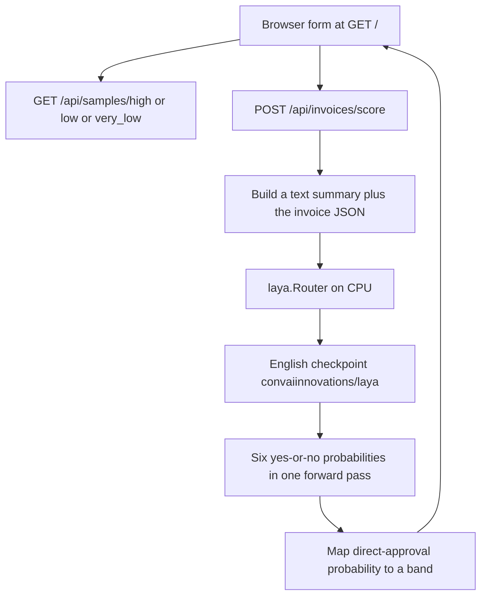

# Laya invoice confidence — end-to-end flow

This proof of concept sends an invoice to the [Laya decision engine](https://github.com/NandhaKishorM/laya) and turns Laya’s probability into an approval route.

Laya is the PyPI package `laya` (installed version 0.4.15). The app calls `Router` from that package. It does not score the invoice with local rules.

## What you do

1. Open http://127.0.0.1:8000.
2. Type an invoice, or load one of the three samples.
3. Click **Score invoice**. The sample buttons score immediately after they fill the form.
4. The page shows a score from 0 to 100, a band, a route, the Laya checkpoint, and Laya’s probability for each statement it was asked.

## Route

Only one number selects the route: Laya’s probability that this statement is true, scaled to 0–100:

> This supplier invoice is complete, consistent, and safe to approve directly with no human review.

The cutoffs are in `app/config.py`.

| Score | Band | Route | Meaning |
| --- | --- | --- | --- |
| 80–100 | High | `DirectApproval` | Approve directly |
| 50–79 | Low | `ManualApproval` | A person must approve or reject |
| 0–49 | Very low | `ManualOnly` | Process manually only |

A supporting answer is marked **Likely** when its own probability is 50% or higher. That mark does not change the route. The route uses only the direct-approval score.

## Flow



The first score after the server starts loads the checkpoint. Later scores reuse the same `Router`. Calls are serialized with a lock so two requests do not run the model at the same time.

## What is sent to Laya

`app/scorer.py` builds a state with three parts:

- `today` — today’s date, so Laya can judge whether the invoice date is in the future.
- `summary` — one paragraph: supplier, tax id, invoice number, dates, currency, PO number, net, tax, total, and each line.
- `invoice` — the same fields as JSON.

Laya is then asked six `noul` questions in one `router.predict` call. A `noul` answer is the probability, from 0 to 1, that the statement is true.

| Response field | Statement Laya judges |
| --- | --- |
| `DirectApproval` | Complete, consistent, and safe to approve with no human review. This probability is the score. |
| `SupplierIdentity` | Supplier name, invoice number, currency, and supplier tax id are present. |
| `DatesValid` | Invoice date is on or before today, and any due date is on or after the invoice date. |
| `TotalsConsistent` | Line nets sum to the invoice net, and net plus tax equals the total. |
| `PurchaseOrder` | A purchase order number is present. |
| `AmountAcceptable` | The total is positive and not unusually large or suspicious. |

`Router` chooses the checkpoint. English invoice text uses the English checkpoint (`model` is `english`). The response field `engine` is `laya`.

## Request and response

`POST /api/invoices/score`

```json
{
  "supplierName": "Acme Supplies",
  "supplierTaxId": "IE1234567T",
  "invoiceNumber": "INV-10045",
  "invoiceDate": "2026-10-01",
  "dueDate": "2026-10-31",
  "currency": "EUR",
  "poNumber": "PO-7781",
  "netAmount": 1000.0,
  "taxAmount": 230.0,
  "totalAmount": 1230.0,
  "lines": [
    {
      "description": "Consulting",
      "quantity": 1,
      "unitPrice": 1000.0,
      "netAmount": 1000.0
    }
  ]
}
```

```json
{
  "score": 88,
  "band": "High",
  "route": "DirectApproval",
  "summary": "Invoice can be approved directly.",
  "engine": "laya",
  "model": "english",
  "reasons": [
    {
      "check": "DirectApproval",
      "passed": true,
      "detail": "This supplier invoice is complete, consistent, and safe to approve directly with no human review. Laya probability 88%.",
      "points": 88,
      "maxPoints": 100
    }
  ]
}
```

`points` on each reason is that statement’s probability as a percent. `passed` is true when that probability is at least 50%. If Laya fails to load or to return a probability, the API responds with HTTP 503.

Other endpoints:

- `GET /` — the form in `app/static/index.html`.
- `GET /api/routing` — the three bands, read from `app/config.py`.
- `GET /api/samples/{high|low|very_low}` — the sample invoice JSON.

## Samples

The files in `app/samples/` are example invoices, not guaranteed scores.

| Button | File | What is different |
| --- | --- | --- |
| Complete invoice | `high.json` | Supplier, tax id, dates, PO, and totals all agree. |
| Missing PO | `low.json` | Same invoice with an empty PO number. |
| Totals do not match | `very_low.json` | The line net is 1000 and the invoice net is 400. |

On a local run of the shipped English checkpoint, all three scored about 88–91 and took the direct-approval route. Laya also warns that confidence from this checkpoint should be treated as uncalibrated. The zero-shot model does not yet separate a missing PO or a broken total from a clean invoice. The [Laya fine-tuning guide](https://github.com/NandhaKishorM/laya/blob/main/README.md) is the path to a checkpoint trained on your own invoices.

## Code map

| File | Role |
| --- | --- |
| `app/static/index.html` | Form, sample buttons, and the result panel. |
| `app/main.py` | HTTP routes. |
| `app/models.py` | Invoice and score shapes. |
| `app/scorer.py` | Builds the Laya state, calls `Router.predict`, and maps the probability to a route. |
| `app/config.py` | Band cutoffs, 80 and 50. |
| `app/samples/*.json` | The three example invoices. |
| `requirements.txt` | FastAPI, Uvicorn, and `laya`. |

## Run

```powershell
cd C:\Users\p.hanumant.tapkir\source\Repos\LayaInvoicePoc
.\.venv\Scripts\python.exe -m uvicorn app.main:app --reload
```

Open http://127.0.0.1:8000.

Laya runs on CPU (`Router(device="cpu")`). The first score downloads or loads the checkpoint and is slower than the ones after it.
